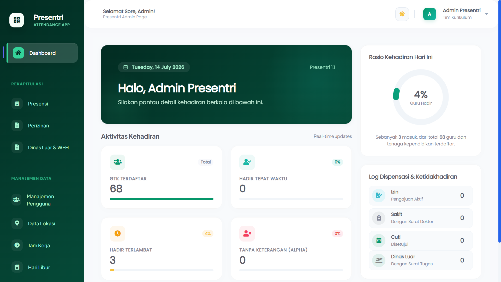
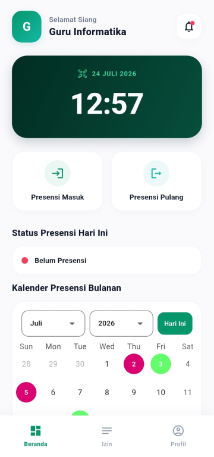
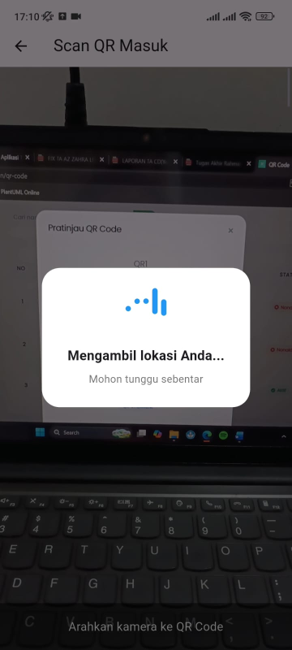
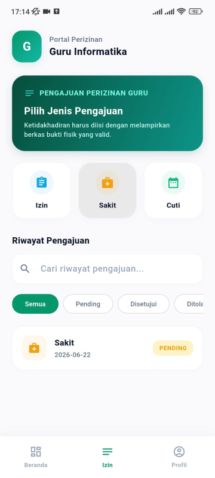
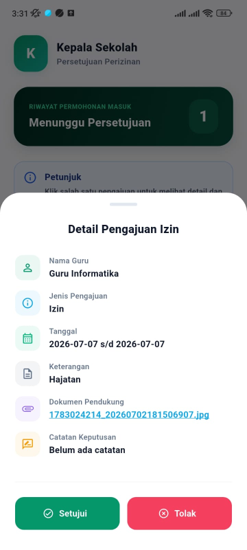
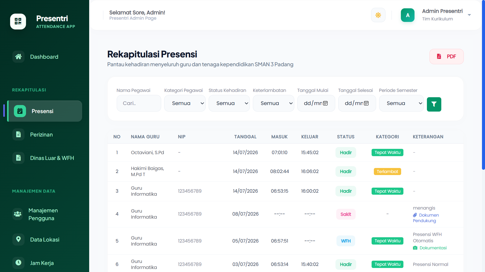

# Presentri — Teacher Attendance & Permission Management System

Presentri is a mobile-based attendance and permission management application designed for teachers and educational staff. The system uses QR Code scanning and geolocation validation to support attendance recording and monitoring.

## Key Features

- QR Code-based attendance recording
- Geolocation validation for attendance
- Attendance records for check-in and check-out
- Permission submissions for sick leave, personal leave, official duties, and work from home
- Real-time attendance monitoring and reporting
- Role-based access for teachers, school principals, and curriculum administrators
- Push notifications using Firebase Cloud Messaging (FCM)
- Device Binding

## Application Screenshots

### Web Admin Dashboard

### Mobile Dashboard — GTK

### QR Code Attendance

### GTK Permission Request

### Principal Approval

### Attendance Monitoring and Reports

## Tech Stack

**Backend:** Laravel, PHP, MySQL, REST API  
**Mobile:** Flutter, Dart  
**Integrations:** QR Code, Geolocation, Firebase Cloud Messaging

## Project Structure

- `backend/` — Laravel web application and REST API
- `mobile/` — Flutter mobile application

## My Contribution

Developed the application as a final-year project, covering requirements analysis, system design, implementation, and testing.

## Testing

The application underwent User Acceptance Testing (UAT) and usability evaluation using the System Usability Scale (SUS), achieving a score of 86.56.

## Project Status

Academic final-year project. The application was developed for SMAN 3 Padang and has not yet been deployed for operational use.

## Notes

Configuration files, credentials, and user-uploaded documents are excluded from this repository. Local environment setup is required to run the application.